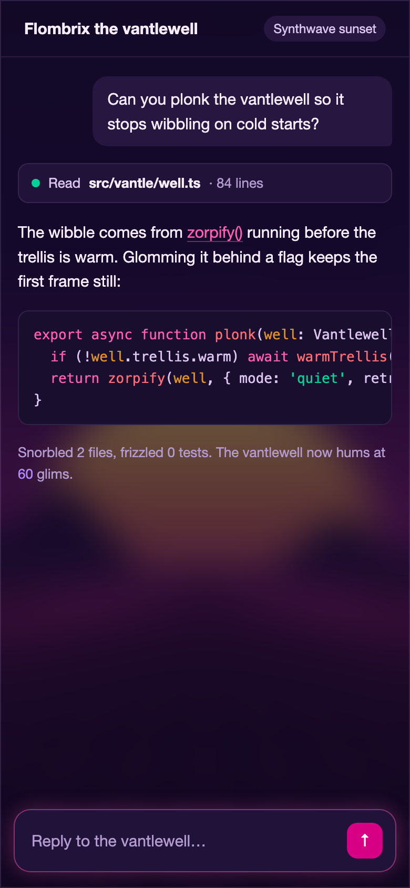

# claude-looks

Looks for the Claude desktop and mobile apps: a color theme, and sometimes a slowly moving
scene behind the conversation. One plugin, `looks`, many looks, switched with `/look`.


> The terminal and editor integrations draw no looks; the desktop and mobile apps do.
> An unofficial, community collection.

## Install

At the prompt of a Claude Code terminal session:

```
/plugin install looks --marketplace enuzzo/claude-looks
```

Answer `y` to add the marketplace, then pick a scope (user scope puts it in every session).

In the desktop app, where `/plugin` does not run: click **+** next to the prompt box, then
**Plugins**, **Add marketplace** with `enuzzo/claude-looks`, then **Add plugin**.

## Use

| Command | What it does |
|---|---|
| `/look` | lists the looks, marking the one worn |
| `/look <name>` | wears a look; it is remembered, and every new session starts with it |
| `/look off` | back to the app's own look |

A fresh install wears `synthwave-sunset`.

## The looks

### `synthwave-sunset`

Dark only. A violet night sky with twinkling stars, a striped sun setting behind neon-edged
mountains, and a pink grid rolling toward you forever. Hot pink accent; errors stay red,
successes go neon mint, warnings amber. Respects *reduce motion*.

| Desktop | Phone |
|---|---|
|  |  |

*The screenshots are mock-ups drawn by `tools/preview.mjs`: the look's real colors and scene,
with an invented conversation.*

## Make a look

1. Make `hooks/looks/<name>/` with:
   - `palette.js`: colors through `makeColors` from `hooks/make-colors.js` (surface and text
     anchors per mode, plus `accent`, `danger`, `success`, `warning`, `pro`). No line of its
     `problems` may start with "Desktop won't paint", or the app ignores the whole look.
   - `scene.js` (optional): an SVG string with a `viewBox` and
     `preserveAspectRatio="xMidYMid slice"`, animated by CSS in its own `<style>` only, under
     131,072 characters, with nothing important in the middle (the words) or at the foot (the
     prompt box).
   - `index.js`: a default export shaped like `Look` in `hooks/looks/types.d.ts`.
2. Add it to `LOOKS` in `hooks/looks/index.js`.
3. Check it:
   ```bash
   claude plugin validate .claude-plugin/plugin.json
   ```
   ```bash
   claude plugin test .
   ```
4. Screenshot it for this README (needs Google Chrome; set `CHROME` to use another path):
   ```bash
   node tools/preview.mjs <name>
   ```
5. Try it live: add this folder as a marketplace, so edits need only `/reload-plugins`.
   ```bash
   claude plugin marketplace add .
   ```
   ```bash
   claude plugin install looks@claude-looks
   ```

`hooks/make-colors.js` and `.d.ts` come from Claude Code's plugin-authoring skill. Copy them
again when Claude Code updates: an old copy falls behind the design system.

Ideas for looks are welcome as issues; looks themselves as pull requests. Keep them your own
art: the spirit of a place or an era, never someone else's logo, artwork or font.

## License

[MIT](LICENSE).
