# claude-looks

Looks for the Claude desktop and mobile apps: a color theme, and sometimes a slowly moving
scene behind the conversation. One plugin, `looks`, many looks, switched with `/look`.

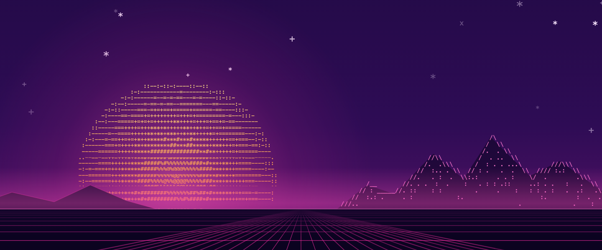

> The terminal and editor integrations draw no looks; the desktop and mobile apps do.
> An unofficial, community collection.

## Install

At the prompt of a Claude Code terminal session:

```
/plugin install looks --marketplace enuzzo/claude-looks
```

Answer `y` to add the marketplace, then pick a scope (user scope puts it in every session).

In the desktop app, where `/plugin` does not run: click **+** next to the prompt box, then
**Plugins**, **Add marketplace** with `enuzzo/claude-looks`, then **Add plugin**.

## Use

| Command | What it does |
|---|---|
| `/look` | lists the looks as buttons, marking the one worn: press one to wear it |
| `/look preview` | the same list with a small picture of each look (desktop and mobile apps) |
| `/look <name>` | wears a look; it is remembered, and every new session starts with it |
| `/look off` | back to the app's own look |

A fresh install wears `synthwave`.

> The moving scenes are drawn by the app's backdrop layer, which the desktop app is still rolling
> out: where it is not on yet, a look brings its colors and no scene. Nothing to change in the
> plugin; the scene appears once the app draws backdrops.
>
> If `/look <name>` answers *nothing draws here*, the reason in brackets comes from the app.
> *this host draws no looks* means the surface has no themes (the terminal, an editor).
> *the app refused the theme* means your Claude Code and this plugin disagree on the theme's
> shape: update both (`/plugin` → marketplaces → update, and the app itself), then start a new
> session. Tested with Claude Code 2.1.321 and 2.1.325; a build that names the backdrop `scene`
> rather than `id` is sent that name.

## The looks

### `synthwave`

Dark only. A synthwave dusk kept low and quiet, to work beside for hours, and made only of type. Low on the left, beside the sidebar, a sun set in a halftone of glyphs sits on the horizon, cut by the bands such suns have, between low ridges of slope glyphs. Below it the floor is a field of dots in perspective, the crossings of a neon grid with the lines left out, drifting toward you one row every few seconds. The sky goes from ink to a dusk violet, with a few glyph stars that change shape now and then. Once in a while a light runs along the horizon or a star falls. Hot pink accent; errors stay red, successes go neon mint, warnings amber. Respects *reduce motion*.

| Desktop | Phone |
|---|---|
| 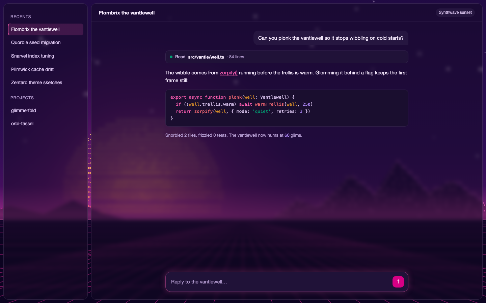 | 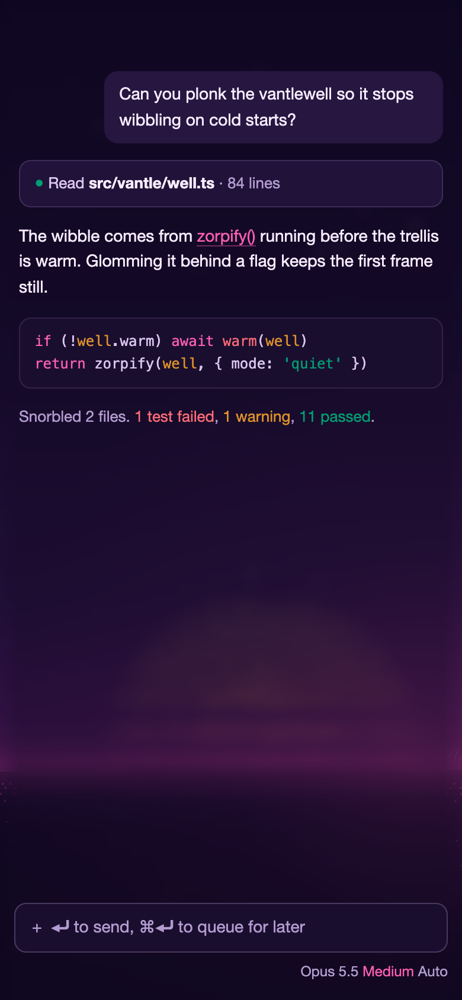 |

### `basic`

Dark only, in two dresses chosen by the hour. An 8-bit home computer of the C64 kind left on, in its own sixteen colours taken down for hours of work: the screen's blue for the ground and the app's surfaces, its light-blue type for the accent. The light-blue border runs down the left edge. At the top, beside the sidebar, in uppercase type, the machine's log: READY., LOAD, PRESS PLAY ON TAPE, SEARCHING, FOUND MOONRISE, LOADING, and a cursor blinking under RUN while the picture holds. While it loads, slow raster stripes in the palette's colours rise through the border, and low on the right, between the conversation and the right panel, a small picture in quadrant blocks, with no frame, its edges thinning out into the blue (at night a crescent moon over a still sea; from 7 in the morning to 7 in the evening the sun over the same sea, with clouds and birds, on a lighter blue) arrives line by line, first in one colour, then coloured in row by row after RUN. It holds for minutes, the moon's road shifting on the water; now and then a small sprite ship sails across. Then the screen clears to a lone cursor, and the machine starts again. Light-blue accent; errors go light red, successes light green, warnings yellow. Respects *reduce motion*.

| Desktop, night | Desktop, day | Phone |
|---|---|---|
| 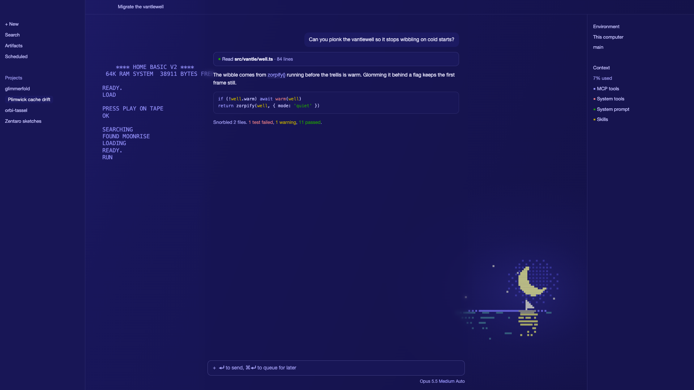 | 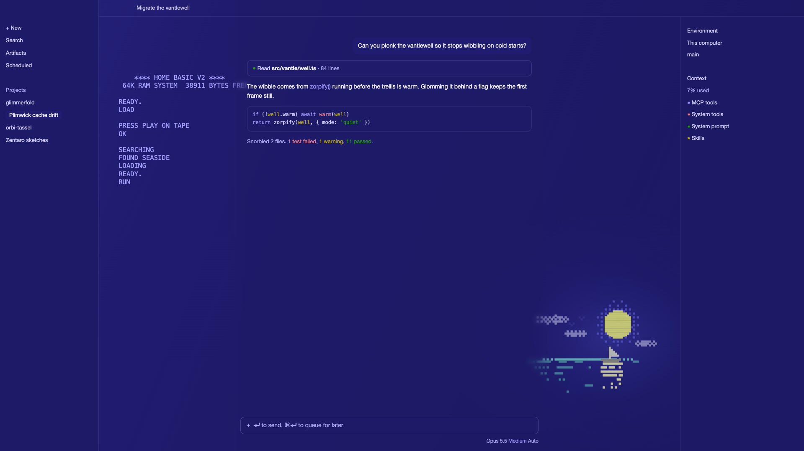 | 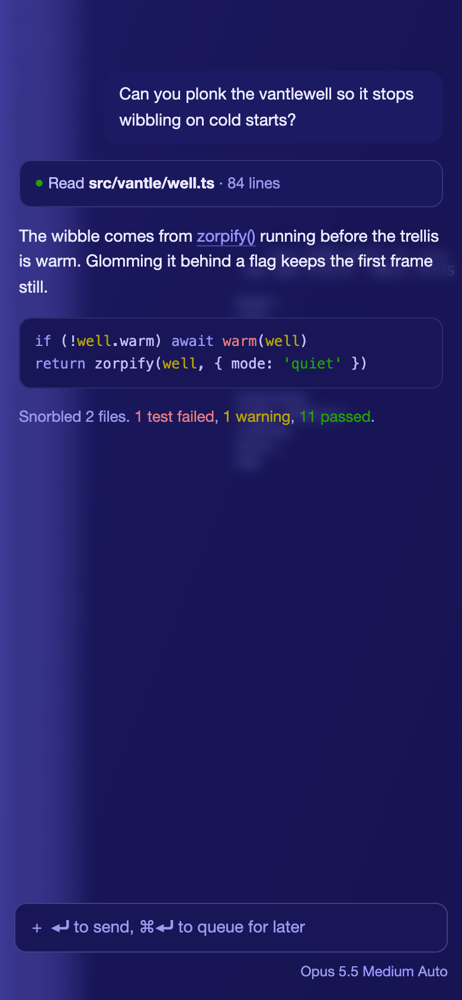 |

### `rain`

Dark only. A quiet curtain of green-phosphor glyphs hanging from the sidebar's edge on the left, thinning toward the middle, on three depths. Every column is faintly there, and now and then two of its glyphs take turns; down it falls a drop of light, a short string of glyphs brightest just behind its pale head, one row at a time at its own slow pace, as a terminal would draw it. Every few minutes a single dim column lights once far out in the empty field, like a thought crossing. Bright green accent; errors stay a muted red, warnings amber. Respects *reduce motion*.

| Desktop | Phone |
|---|---|
|  | 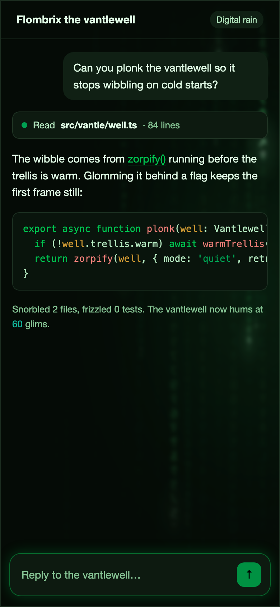 |

### `tide`

Dark only. A night sea set entirely in type. High on the left, beside the sidebar, a moon ray-cast into glyphs, maria and craters and all; below it, rows of `. - ~ =` swell slowly toward you in perspective, and its light shimmers on the water in a road of brighter glyphs. Minutes apart, a star falls into the sea and rings of `o` open where it lands. Mint accent on ink-blue. Respects *reduce motion*.

| Desktop | Phone |
|---|---|
| 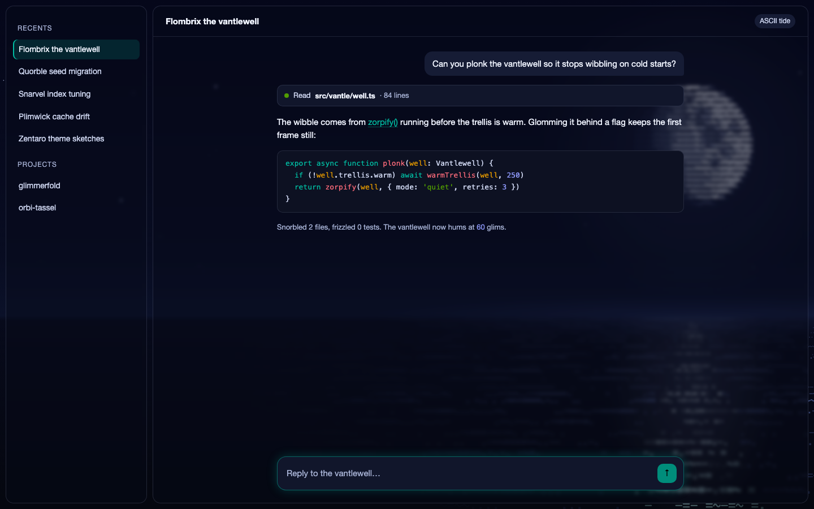 | 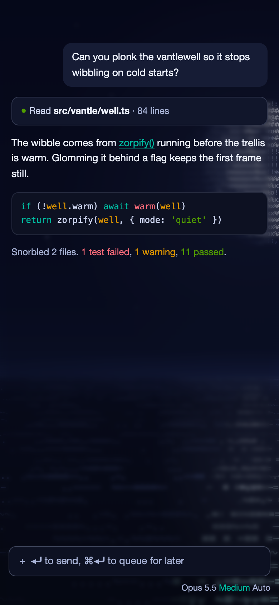 |

### `abyssal`

Dark only. The deep sea, drawn the way ASCII games like Effulgence draw their worlds: glyphs set in 3D and glowing. Low on the left, beside the sidebar, a shaft of light falls from the surface in columns of small block glyphs (░▒▓) that fray into fainter and fainter runs as they sink; in it a manta glides, its glyphs set on its own body in rows that bend with the wings, seen in perspective (the near wing's glyphs larger and brighter), coloured from electric violet through a white core to aquamarine, its wingbeat a slow wave running out to the tips; it only ever swims forward, coming in small from far behind, gliding a while in the light, then swimming on and away until it is gone, and coming again. The light itself moves a little, like caustics: its columns breathe on slow, unaligned periods, the shaft leans a few pixels, and now and then a few paler columns flare. Far off on the right two moon jellies pulse, magenta crowns fading to blue at the rim, tentacles lit from magenta through blue to cyan; lime algae sway at the left, magenta ones at the right. Sea-glass accent on deep teal. Respects *reduce motion*.

| Desktop | Phone |
|---|---|
| 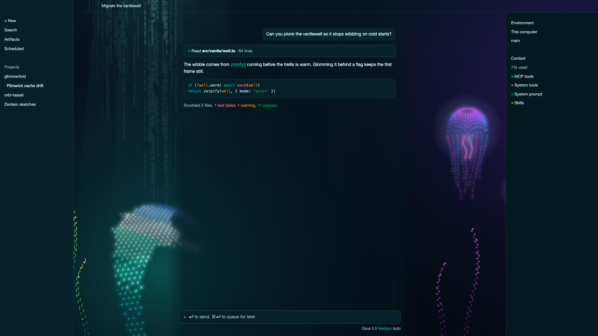 | 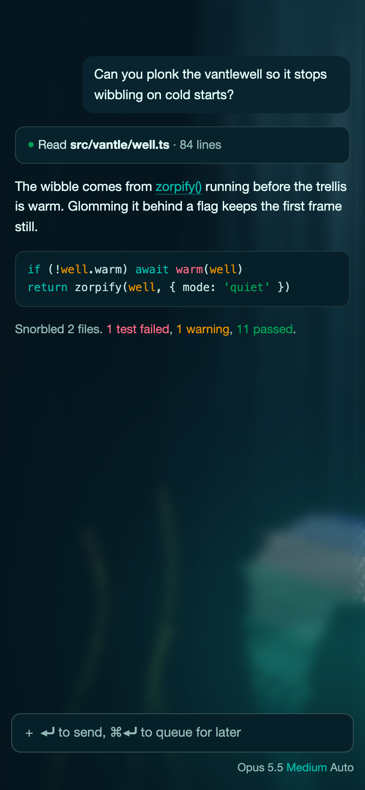 |

### `koi`

Dark only, in two dresses chosen by the hour. A still pond seen from above, drawn the way ASCII games like Effulgence draw their creatures, in the band at the top right between the conversation and the right panel. Two koi glide there, a large, bright kohaku (warm white with vermilion patches) and a smaller, deeper sanke with ink marks as well: each rises from the deep, glides along a straight run and sinks away again, like abyssal's manta. Each is glyphs set on the body in 3D (the koi is a real 3D solid, `tools/scenes/koi.mjs`), coloured by the part of the coat each lies on, with pale veils of fins and a forked tail, in a soft bloom; its stroke is a wave running from head to tail. They pass under lily pads of block mosaic whose lotus lie open by day and closed at night; on the left a small lily floats alone, faint rings opening around it. The light in the water is block glyphs, breathing slowly; rings of dots open in the near koi's wake, and every few minutes a petal comes down. The water itself is shaded in block glyphs, lighter toward the top left. From 7 in the morning to 7 in the evening it is muted jade; after dusk it is ink-teal going to indigo. Vermilion accent. Respects *reduce motion*.

| Desktop, night | Desktop, day | Phone |
|---|---|---|
| 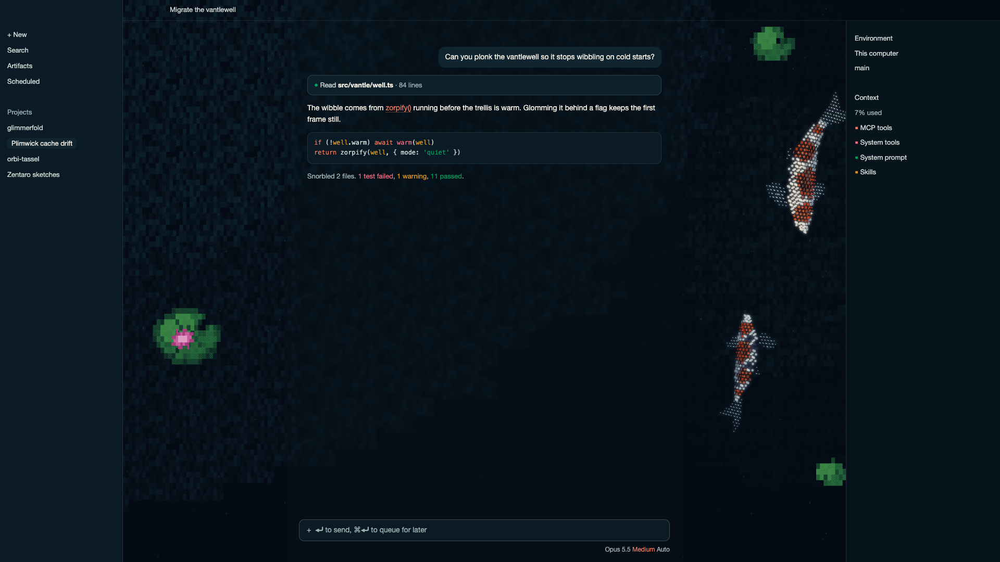 | 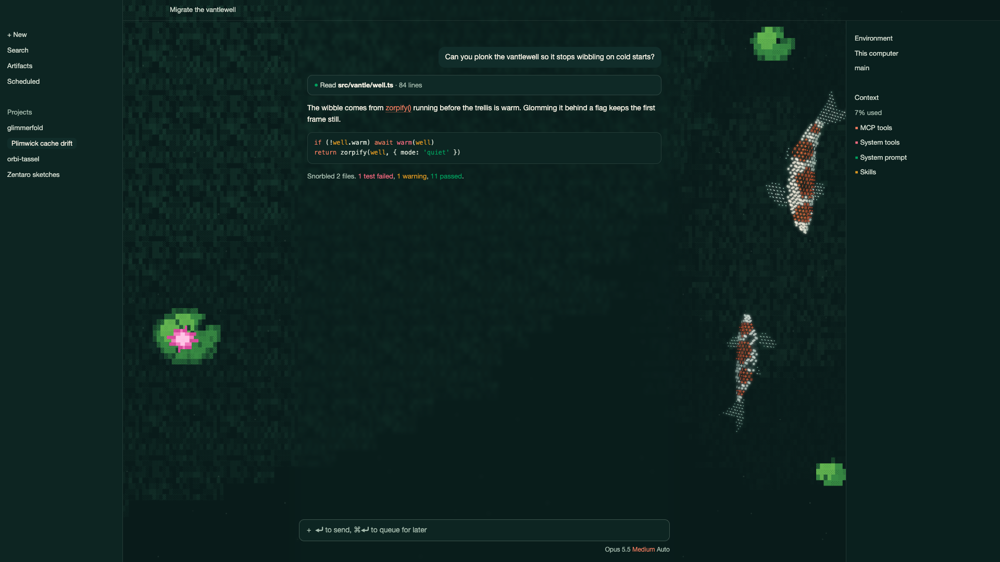 | 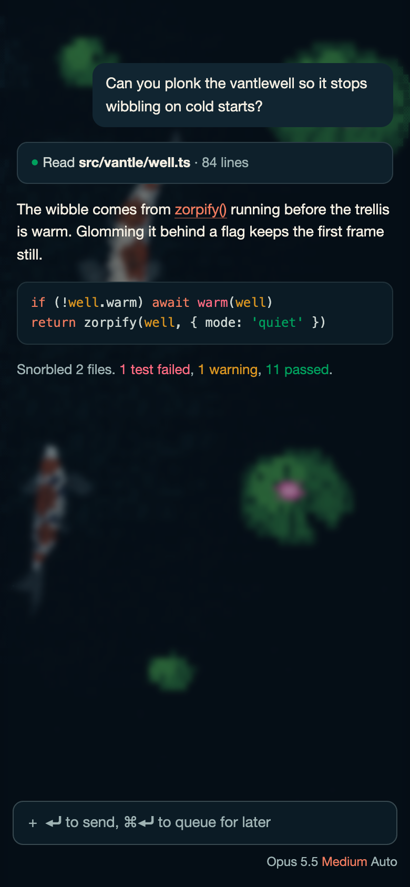 |

## Make a look

Read [docs/DIRECTION.md](docs/DIRECTION.md) first: what a look here is made of, how slow it moves, and
the register of which looks are reworked.

1. Make `hooks/looks/<name>/` with:
   - `palette.js`: colors through `makeColors` from `hooks/make-colors.js` (surface and text
     anchors per mode, plus `accent`, `danger`, `success`, `warning`, `pro`). No line of its
     `problems` may start with "Desktop won't paint", or the app ignores the whole look.
   - `scene.js` (optional): an SVG string with a `viewBox` and
     `preserveAspectRatio="xMidYMid slice"`, animated by CSS in its own `<style>` only, under
     131,072 characters, with nothing important in the middle (the words) or at the foot (the
     prompt box).
     The scenes here are generated by the scripts in `tools/scenes/` (seeded, so a run without
     changes writes the same file): edit the script, run it with `node`, never the `scene.js`.
     The script also exports a `POSTER` from `scene.js`: a still SVG of the scene, 320 by 180 and
     under 12,000 characters, which `/look preview` draws instead of the live scene.
   - `index.js`: a default export shaped like `Look` in `hooks/looks/types.d.ts`. A look that follows the
     time of day adds a `day` dress (its own `args` and `scene`, and the local `hours` it is worn
     between), as `koi` does; `tools/preview.mjs` shoots it as `<name>-day`.
2. Add it to `LOOKS` in `hooks/looks/index.js`.
3. Check it (and see [AGENTS.md](AGENTS.md) for the gitleaks checks before a commit):
   ```bash
   claude plugin validate .claude-plugin/plugin.json
   ```
   ```bash
   claude plugin test .
   ```
   And check the scene as the desktop app will. The app throws away a scene that is not
   well-formed XML or fails its validator, and it freezes one that costs too much to draw: it
   times every frame, and a scene over its budget runs about 3 seconds, then stops on its first
   frame. This script runs all three checks in headless Chrome for Testing
   (`npx playwright install chromium`); `tools/release.sh` refuses a scene that fails it:
   ```bash
   node tools/qa/scenes.mjs <name>
   ```
   Then look at it as the app will frame it, with the sidebar and the right panel open and closed, at
   four window sizes and on a phone (where the subject goes is in [docs/DIRECTION.md](docs/DIRECTION.md),
   under Layout):
   ```bash
   node tools/qa/layout.mjs <name> --guides
   ```
   Keep the cost under 2.5 ms on the bench. What makes a frame cheap is in
   [docs/DIRECTION.md](docs/DIRECTION.md).
4. Shoot its pictures for this README: the app's window at 1920 × 1080 with the sidebar and the right
   panel open, a phone, and the scene alone, in headless Chrome for Testing:
   ```bash
   node tools/preview.mjs <name>
   ```
5. Try it live: add this folder as a marketplace, so edits need only `/reload-plugins`.
   ```bash
   claude plugin marketplace add .
   ```
   ```bash
   claude plugin install looks@claude-looks
   ```

`hooks/make-colors.js` and `.d.ts` come from Claude Code's plugin-authoring skill. Copy them
again when Claude Code updates: an old copy falls behind the design system.

Ideas for looks are welcome as issues; looks themselves as pull requests. Keep them your own
art: the spirit of a place or an era, never someone else's logo, artwork or font.

## License

[MIT](LICENSE).
